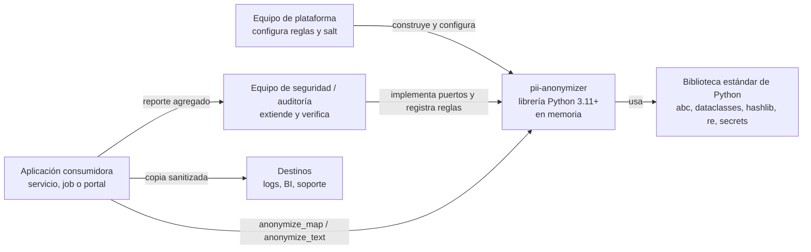
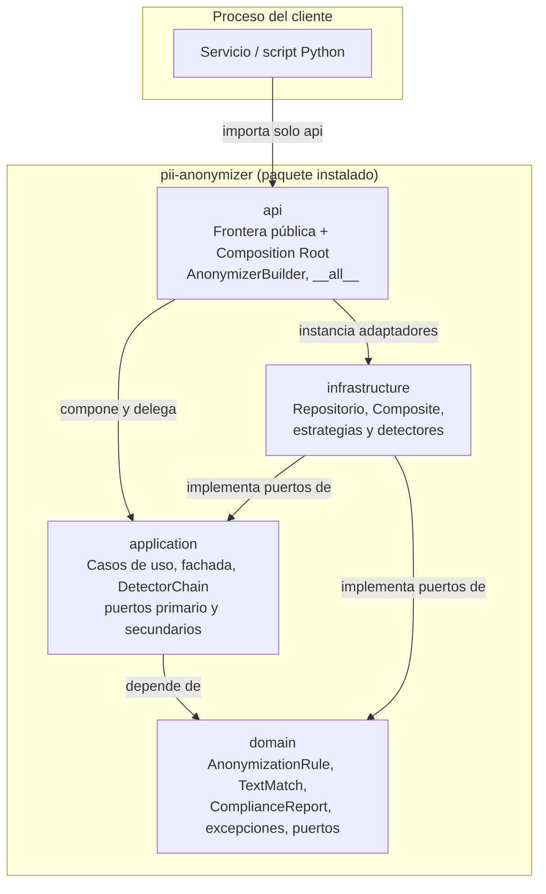
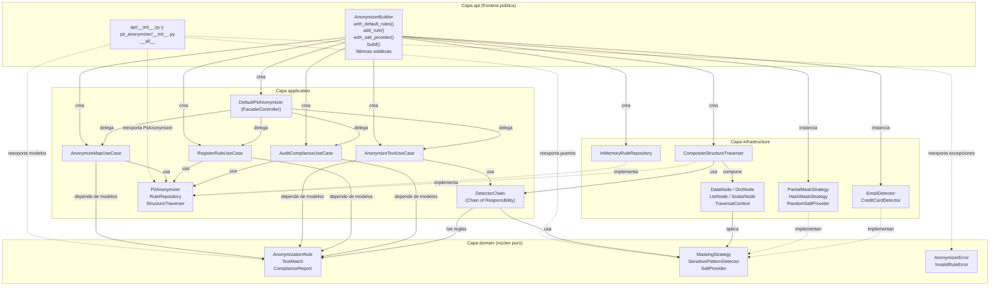

# Arquitectura C4

Este documento describe el componente en tres niveles C4: contexto (C1), contenedores (C2) y componentes (C3). Los diagramas reflejan los paquetes y clases reales de la versión 1.0.0.

## 1. Nivel C1 — Contexto



**Lectura:** la librería no depende de servicios externos. El consumidor decide qué hacer con la salida sanitizada. El equipo de auditoría interactúa mediante los puertos públicos y el reporte agregado.

## 2. Nivel C2 — Contenedores

En este contexto, el “sistema” es un único paquete instalable. Los contenedores lógicos son las capas de Arquitectura Limpia.



### Contenedores y responsabilidades

| Contenedor | Responsabilidad | Dependencias permitidas |
| --- | --- | --- |
| `api` | Reexportar contratos, construir el grafo de objetos | `domain`, `application`, `infrastructure` |
| `application` | Orquestar casos de uso, cadena de detección y fachada | `domain` |
| `domain` | Modelos inmutables, excepciones y puertos | Ninguna capa; solo biblioteca estándar |
| `infrastructure` | Adaptadores concretos: persistencia, recorrido, estrategias, detectores | `domain`, `application` |

## 3. Nivel C3 — Componentes por capa



### Mapa de clases por componente

| Componente | Clases / interfaces principales |
| --- | --- |
| Frontera | `AnonymizerBuilder`, exports de `api/__init__.py` |
| Aplicación | `DefaultPiiAnonymizer`, los cuatro casos de uso, `DetectorChain`, `AppliedMask` |
| Dominio | `AnonymizationRule`, `TextMatch`, `ComplianceReport`, `AnonymizerError`, `InvalidRuleError`, `MaskingStrategy`, `SensitivePatternDetector`, `SaltProvider` |
| Persistencia | `InMemoryRuleRepository` |
| Recorrido | `CompositeStructureTraverser`, `TraversalContext`, `DataNode`, `DictNode`, `ListNode`, `ScalarNode` |
| Estrategias | `PartialMaskStrategy`, `HashMaskStrategy`, `RandomSaltProvider` |
| Detectores | `EmailDetector`, `CreditCardDetector` |

## 4. Justificación de la Regla de Dependencia

La Regla de Dependencia exige que las dependencias de código fuente apunten hacia políticas de más alto nivel. En este diseño:

1. **`domain` no conoce a nadie.** Contiene los objetos de valor y los puertos que describen *qué* necesita el negocio (`mask`, `detect`, `get_salt`). No importa `application`, `infrastructure` ni `api`.
2. **`application` solo conoce `domain`.** Los casos de uso orquestan reglas y estructuras, pero no saben si el repositorio es en memoria o si el recorrido usa Composite.
3. **`infrastructure` conoce `domain` y `application`.** Implementa los puertos con `re`, `hashlib`, `secrets` y estructuras de Python. Es reemplazable sin tocar los casos de uso.
4. **`api` conoce todas las capas.** Es el *Composition Root*: el único lugar donde se permite conocer simultáneamente interfaces e implementaciones para ensamblar el grafo. Esta excepción es deliberada y localizada.
5. **El cliente solo conoce `api`.** No importa `_internal`, por lo que la implementación puede evolucionar sin romper contratos.

### Verificación de la regla

```bash
# Debe devolver vacío: dominio no importa capas externas
grep -r "pii_anonymizer\._internal\.\(application\|infrastructure\|api\)" src/pii_anonymizer/_internal/domain

# Debe devolver vacío: aplicación no importa infraestructura ni api
grep -r "pii_anonymizer\._internal\.\(infrastructure\|api\)" src/pii_anonymizer/_internal/application

# Debe devolver vacío: pruebas y ejemplo no importan _internal
grep -r "pii_anonymizer\._internal" tests examples
```

En Windows PowerShell puede usarse `Select-String` con patrones equivalentes.

## 5. Flujo de una llamada

```text
Cliente
  → api.AnonymizerBuilder.build()              (una vez)
  → PiiAnonymizer.anonymize_map(data)
  → DefaultPiiAnonymizer
  → AnonymizeMapUseCase
  → RuleRepository.get_all()
  → StructureTraverser.traverse(data, rules)
  → CompositeStructureTraverser + DictNode/ListNode/ScalarNode
  → MaskingStrategy / DetectorChain / SensitivePatternDetector
  → ComplianceReport
```

La secuencia detallada se encuentra en [`diagramas-uml.md`](diagramas-uml.md).

## 6. Decisiones de despliegue

- El paquete se distribuye como *wheel* puro (`py3-none-any`) generado por `setuptools`.
- No requiere servicios, puertos ni credenciales para operar.
- El *salt* se obtiene en tiempo de ejecución; si se usa un proveedor externo, el cliente lo inyecta.
- La librería es adecuada para procesos síncronos y de corta duración. Para *streams* masivos, el consumidor debe fragmentar la entrada y monitorear memoria.
