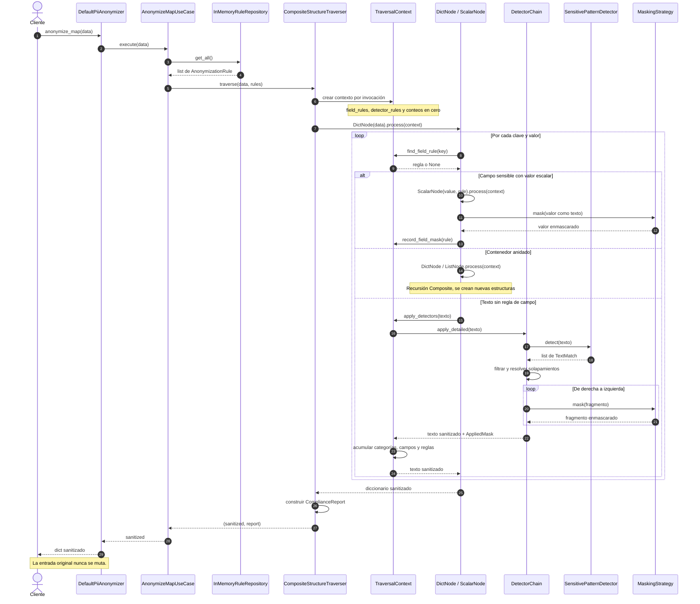
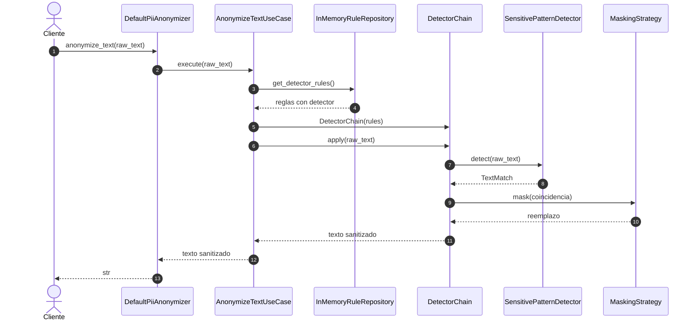

# Diagramas UML

Los diagramas Mermaid de este documento representan las clases y colaboraciones reales de `pii-anonymizer` 1.0.0.

## Diagrama Draw.io editable

El componente tiene un diagrama de clases editable:

| Alcance | Archivo | Contenido |
| --- | --- | --- |
| Componente `pii-anonymizer` | [diagrama-clases-componente.drawio](diagrama-clases-componente.drawio) | Capas `api`, `application`, `domain` e `infrastructure`, puertos, casos de uso, patrones Builder, Facade, Composite, Strategy y Chain. |

El archivo se abre y edita con [Draw.io](https://app.diagrams.net/) o con la aplicación de escritorio.

La app de demostración tiene su **propio diagrama independiente** en su repositorio:
[diagrama-clases-app-taller.drawio](https://github.com/danielromo2001/pii-anonymizer-workshop-app/blob/main/docs/diagrama-clases-app-taller.drawio).
No es una figura combinada con la del componente: cada repositorio documenta su alcance.

## 1. Diagrama de clases

```mermaid
classDiagram
    direction LR

    namespace Api {
        class AnonymizerBuilder {
            -dict _pending_rules
            -SaltProvider _salt_provider
            -bool _include_defaults
            +with_default_rules() AnonymizerBuilder
            +add_rule(rule) AnonymizerBuilder
            +with_salt_provider(provider) AnonymizerBuilder
            +build() PiiAnonymizer
            +partial_mask_strategy(prefix, suffix, char) MaskingStrategy
            +hash_mask_strategy(provider, length) MaskingStrategy
            +email_detector() SensitivePatternDetector
            +credit_card_detector() SensitivePatternDetector
            -_default_rules(provider) list
        }
    }

    namespace Domain {
        class AnonymizationRule {
            +str rule_id
            +MaskingStrategy strategy
            +tuple field_names
            +SensitivePatternDetector detector
            +__post_init__() None
        }
        class TextMatch {
            +str category
            +int start
            +int end
            +str matched_text
        }
        class ComplianceReport {
            +int total_fields_scanned
            +int anonymized_fields_count
            +dict detected_categories
            +tuple applied_rule_ids
            +__post_init__() None
        }
        class AnonymizerError {
        }
        class InvalidRuleError {
        }
        class MaskingStrategy {
            <<interface>>
            +mask(raw_value) str
        }
        class SensitivePatternDetector {
            <<interface>>
            +str category
            +detect(text) list
        }
        class SaltProvider {
            <<interface>>
            +get_salt() str
        }
    }

    namespace Application {
        class PiiAnonymizer {
            <<interface>>
            +anonymize_map(data) dict
            +anonymize_text(raw_text) str
            +register_rule(rule) None
            +audit_compliance(data) ComplianceReport
        }
        class RuleRepository {
            <<interface>>
            +save(rule) None
            +get_all() list
            +find_by_field(field_name) AnonymizationRule
            +get_detector_rules() list
        }
        class StructureTraverser {
            <<interface>>
            +traverse(data, rules) tuple
        }
        class DefaultPiiAnonymizer {
            -AnonymizeMapUseCase _anonymize_map_use_case
            -AnonymizeTextUseCase _anonymize_text_use_case
            -RegisterRuleUseCase _register_rule_use_case
            -AuditComplianceUseCase _audit_compliance_use_case
            +anonymize_map(data) dict
            +anonymize_text(raw_text) str
            +register_rule(rule) None
            +audit_compliance(data) ComplianceReport
        }
        class AnonymizeMapUseCase {
            +execute(data) dict
        }
        class AnonymizeTextUseCase {
            +execute(raw_text) str
        }
        class RegisterRuleUseCase {
            +execute(rule) None
        }
        class AuditComplianceUseCase {
            +execute(data) ComplianceReport
        }
        class DetectorChain {
            -_DetectorHandler _head
            +apply(text) str
            +apply_detailed(text) tuple
            -_resolve_overlaps(candidates, length) list
        }
        class AppliedMask {
            +str rule_id
            +str category
            +int start
            +int end
        }
        class _DetectorHandler {
            -AnonymizationRule _rule
            -SensitivePatternDetector _detector
            -_DetectorHandler _next
            +set_next(next) _DetectorHandler
            +handle(text, collected) None
        }
        class _Candidate {
            +TextMatch match
            +MaskingStrategy strategy
            +str rule_id
            +str category
        }
    }

    namespace Infrastructure {
        class InMemoryRuleRepository {
            -dict _rules
            +save(rule) None
            +get_all() list
            +find_by_field(field_name) AnonymizationRule
            +get_detector_rules() list
        }
        class CompositeStructureTraverser {
            +traverse(data, rules) tuple
        }
        class TraversalContext {
            +dict field_rules
            +tuple detector_rules
            +int total_fields_scanned
            +int anonymized_fields_count
            +dict detected_categories
            +dict applied_rule_ids
            -DetectorChain _detector_chain
            +find_field_rule(field_name) AnonymizationRule
            +record_field_mask(rule) None
            +apply_detectors(text) str
        }
        class DataNode {
            <<abstract>>
            +process(context) object
        }
        class DictNode {
            +process(context) dict
        }
        class ListNode {
            +process(context) list
        }
        class ScalarNode {
            +process(context) object
        }
        class PartialMaskStrategy {
            +mask(raw_value) str
        }
        class HashMaskStrategy {
            +mask(raw_value) str
        }
        class RandomSaltProvider {
            +get_salt() str
        }
        class EmailDetector {
            +str category
            +detect(text) list
        }
        class CreditCardDetector {
            +str category
            +detect(text) list
        }
    }

    InvalidRuleError --|> AnonymizerError
    AnonymizationRule --> MaskingStrategy
    AnonymizationRule --> SensitivePatternDetector

    DefaultPiiAnonymizer ..|> PiiAnonymizer
    DefaultPiiAnonymizer --> AnonymizeMapUseCase
    DefaultPiiAnonymizer --> AnonymizeTextUseCase
    DefaultPiiAnonymizer --> RegisterRuleUseCase
    DefaultPiiAnonymizer --> AuditComplianceUseCase
    AnonymizeMapUseCase --> RuleRepository
    AnonymizeMapUseCase --> StructureTraverser
    AnonymizeTextUseCase --> RuleRepository
    AnonymizeTextUseCase --> DetectorChain
    RegisterRuleUseCase --> RuleRepository
    AuditComplianceUseCase --> RuleRepository
    AuditComplianceUseCase --> StructureTraverser
    DetectorChain --> SensitivePatternDetector
    DetectorChain --> MaskingStrategy
    DetectorChain --> AppliedMask
    DetectorChain --> _DetectorHandler
    _DetectorHandler --> _Candidate
    _DetectorHandler --> AnonymizationRule
    _DetectorHandler --> SensitivePatternDetector

    InMemoryRuleRepository ..|> RuleRepository
    CompositeStructureTraverser ..|> StructureTraverser
    CompositeStructureTraverser --> DataNode
    CompositeStructureTraverser --> TraversalContext
    CompositeStructureTraverser --> ComplianceReport : produce
    DataNode <|-- DictNode
    DataNode <|-- ListNode
    DataNode <|-- ScalarNode
    DictNode --> ScalarNode : crea para hojas
    DictNode --> ListNode : crea para listas
    DictNode --> DictNode : crea para mapas
    ScalarNode --> AnonymizationRule : regla de campo
    TraversalContext --> DetectorChain
    TraversalContext --> AnonymizationRule

    PartialMaskStrategy ..|> MaskingStrategy
    HashMaskStrategy ..|> MaskingStrategy
    HashMaskStrategy --> SaltProvider
    RandomSaltProvider ..|> SaltProvider
    EmailDetector ..|> SensitivePatternDetector
    CreditCardDetector ..|> SensitivePatternDetector
    EmailDetector --> TextMatch
    CreditCardDetector --> TextMatch
    DetectorChain --> TextMatch

    AnonymizerBuilder ..> DefaultPiiAnonymizer : crea
    AnonymizerBuilder ..> InMemoryRuleRepository : crea
    AnonymizerBuilder ..> CompositeStructureTraverser : crea
    AnonymizerBuilder ..> PartialMaskStrategy : crea
    AnonymizerBuilder ..> HashMaskStrategy : crea
    AnonymizerBuilder ..> EmailDetector : crea
    AnonymizerBuilder ..> CreditCardDetector : crea
    AnonymizerBuilder ..> AnonymizationRule : construye reglas
```

### Notas de lectura

- Las interfaces (`..|>`) se implementan mediante herencia de `ABC` y `@abstractmethod`.
- `AnonymizationRule` es un objeto de valor inmutable; su `__post_init__` valida las invariantes.
- `ComplianceReport` copia defensivamente el diccionario y la tupla en su constructor.
- `AppliedMask` es interno de la capa de aplicación y solo transporta metadatos agregables.
- `TraversalContext` se instancia por cada invocación de `traverse`; no se comparte entre llamadas.
- `AnonymizerBuilder` es el único componente con dependencias hacia todas las capas.

## 2. Diagrama de secuencia: `anonymize_map`

## 3. Flujo alternativo: `anonymize_text`

